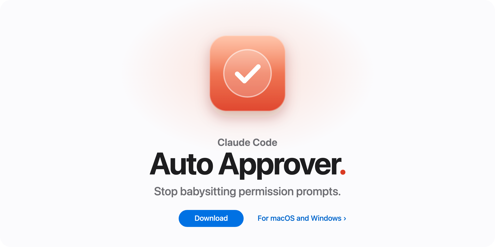
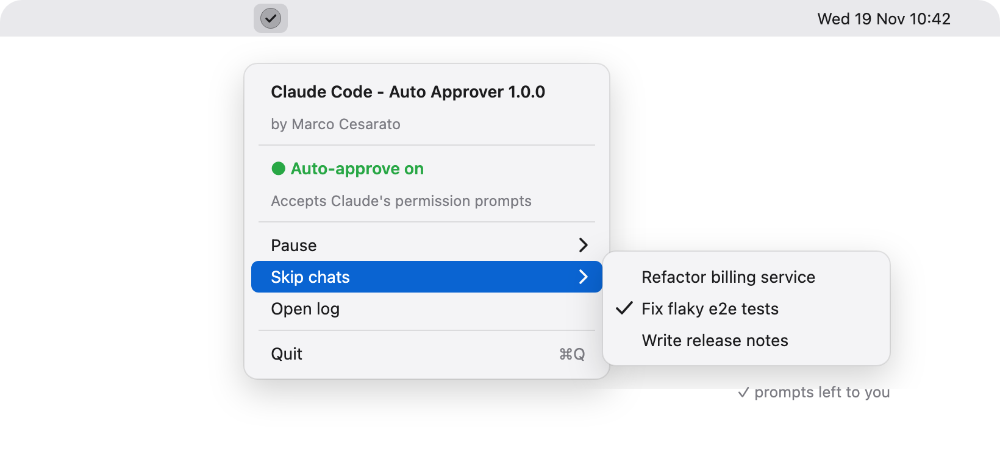
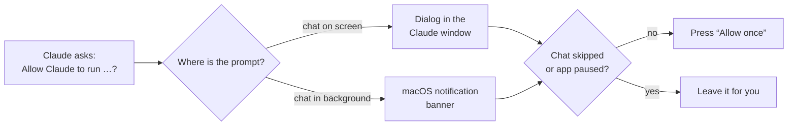

<p align="center">
  <a href="../../releases/latest">
    <picture>
      <source media="(prefers-color-scheme: dark)" srcset="docs/banner-dark.png">
      
    </picture>
  </a>
</p>

<p align="center">
  
  
  
  
  
</p>

<p align="center">
  <b>A tiny menu bar app that presses “Allow once” for you in the Claude desktop app,<br>
  so long Claude Code sessions keep moving while you are somewhere else.</b>
</p>

<p align="center">
  <a href="../../releases/latest"><b>Download</b></a> ·
  <a href="#-how-it-works">How it works</a> ·
  <a href="#-install">Install</a> ·
  <a href="#-safety-first">Safety</a> ·
  <a href="#-faq">FAQ</a>
</p>

---

You start a long task in Claude Code, switch to something else, and come back an hour
later to find it stopped at minute two, waiting for you to approve `ls`. **Auto Approver
ends that.** It watches the Claude desktop app and answers each permission prompt the moment
it appears: in the window you are looking at, and on the notification of a session running
in the background.

<p align="center">
  <picture>
    <source media="(prefers-color-scheme: dark)" srcset="docs/menu-dark.png">
    
  </picture>
</p>

## 💡 Why not just use bypass mode?

Claude Code can skip every prompt with `--dangerously-skip-permissions` (the
`bypassPermissions` mode). Often you cannot, or should not, use it:

- **It is switched off.** Organisations commonly disable bypass mode in managed settings
  for security reasons, and on a company laptop that setting is not yours to change.
- **It is all or nothing.** Bypass mode turns off the whole permission system for the
  session. You keep no switch, no record and no way back short of restarting Claude.

Auto Approver sits in between. Claude Code's permission system stays on, so your `deny`
rules, hooks and managed policies still apply, and only the prompts that actually reach you
are answered. You keep control: **Pause** it for a while, **Skip** the chats you want to
watch, and check the log for each approval it made.

> If your organisation disabled bypass mode precisely so that a person reviews every
> command, this app defeats that intent. Ask before you use it there.

## ✨ Features

|   |   |
|---|---|
| ⚡ **Hands-off** | Presses **Allow once** within about 1.5 seconds, in the window and on banners. |
| 🔔 **Background sessions** | A prompt from a chat you are not looking at arrives as a notification, and it is answered there. |
| ⏸️ **Timed pause** | Pause for 5, 15 or 30 minutes, 1, 3 or 6 hours, or until you resume. A timed pause ends by itself. |
| 🙅 **Skip chats** | Tick a chat and its prompts are left for you, in the window and on its notifications. |
| ☕ **Keeps working** | Stops idle sleep while on, so prompts are still answered with the display off or the screen locked. |
| 🌍 **Speaks your language** | Recognises the button in every language the Claude app offers. Its own menu is in English, Italian, German, Spanish, French, Portuguese and Japanese. |
| 🪶 **Small and private** | A single native app with no dependencies. It makes no network calls and keeps no data beyond a local log. |

## 🛡️ Safety first

Claude Code asks for permission so that a person sees every command before it runs. **This
app removes that check: every tool call Claude makes runs without your review.** Use it only
where you would run Claude Code with permissions bypassed anyway, and never where an
organisation's policy requires manual approval.

What it will never do:

- **Never “Always allow”.** It presses **Allow once** only, so it writes no permanent rule.
- **Never answer questions.** Claude's questions, plan approvals and anything else are left to you.
- **Never phone home.** No network access, no analytics, no account.

When you want to watch a session closely, **Pause** it or **Skip** that chat.

## 🧠 How it works



Every 1.5 seconds the app reads the Claude window and Notification Center through the
macOS **Accessibility** API, the interface screen readers use. It looks for the
**Allow once** button, or the matching notification action, and presses it. It never sends
keystrokes and never moves the mouse.

## 📦 Install

### From a release

1. Download `Claude-Code-Auto-Approver-<version>-macOS.zip` from [Releases](../../releases/latest).
2. Unzip it and move the app to **Applications**.
3. The app is not notarised, so clear the download quarantine once:

   ```bash
   xattr -dr com.apple.quarantine "/Applications/Claude Code - Auto Approver.app"
   ```

4. Open it and grant **Accessibility** when macOS asks, or later in System Settings →
   Privacy & Security → Accessibility.

### From source

```bash
git clone <this repository> && cd claude-code-auto-approver
macos/scripts/install.sh
```

This needs Swift (`xcode-select --install`). The script builds the app, installs it in
`/Applications`, or in `~/Applications` when that folder is not writable, and starts it.

### Windows

A PowerShell version does the same through UI Automation, with no permission to grant. See
[`windows/`](windows/README.md). It does not offer the timed pause or chat skipping yet.

## 🎛️ Using it

The icon in the menu bar is a **filled disc** while the app approves, and a **faint
outline** while it is paused or lacks permission.

| Menu item | What it does |
|---|---|
| **Pause ▸** | Stops approving for 5 min to 6 h, or until you resume. |
| **Resume** | Shown while paused. Turns approving back on now. |
| **Skip chats ▸** | Lists the chats open in the window and those running or waiting in its sidebar. A ticked chat is left to you. |
| **Open log** | Opens what the app saw and pressed. |

A skipped chat is known by its title. If Claude renames the chat, the skip ends, and two
chats with the same title are both skipped.

## 🩺 Troubleshooting

<details>
<summary><b>The icon is an outline and nothing is pressed</b></summary>

The app lacks Accessibility. Turn it on in System Settings → Privacy & Security →
Accessibility. After installing a new build, macOS keeps the old grant but no longer
applies it, because each build carries a new signature. Reset it, then turn it on again:

```bash
tccutil reset Accessibility com.marcocesarato.ClaudeCodeAutoApprover
```
</details>

<details>
<summary><b>A prompt was not accepted</b></summary>

Open the log from the menu (`~/Library/Logs/ClaudeCodeAutoApprover.log`). It lists:

- `🆕 New buttons:` buttons seen in the Claude window. A dialog's buttons appear when it opens.
- `🆕 Notification action:` actions offered by notification banners.
- `⏳ A session is waiting` a session needs you, but no dialog is on screen.

If the button you need has another label, list it in
`~/Library/Application Support/ClaudeCodeAutoApprover/labels.txt`, one per line. A line
starting with `#` is a comment. The file replaces the default list and is read on every
check, so no restart is needed.
</details>

<details>
<summary><b>The Mac went to sleep anyway</b></summary>

The app prevents idle sleep only. A closed lid on battery power still puts the Mac to sleep.
</details>

## ❓ FAQ

**Is this an Anthropic product?** No. It is an independent, unofficial tool. “Claude” and
“Claude Code” are trademarks of Anthropic.

**Why not use Claude Code's own permission settings?** Use them where you can. Allow rules
in `settings.json` are more precise than this app. This app covers the prompts those rules
do not.

**Does it read my conversations?** It reads the window's accessibility tree to find buttons
and chat titles. It writes button labels and the start of each permission request to the
local log, and sends nothing anywhere.

**How do I remove it?**

```bash
macos/scripts/uninstall.sh
```

## 🛠️ Development

```text
macos/                    the macOS app, a Swift package
  sources/core/           labels, chats and translations; pure and tested
  sources/app/            menu, monitor, Accessibility walkers, notifications
  tests/                  Swift Testing suites for the core
  resources/Info.plist    bundle metadata; the version lives here
  scripts/                build-app.sh, install.sh, uninstall.sh, make-icon.swift
windows/                  the PowerShell version
docs/                     README art: make-art.py draws each picture as SVG and 2x PNG
.github/workflows/        CI on every push, a release on every v* tag
```

```bash
cd macos
swift test               # the core's tests
scripts/build-app.sh     # build/Claude Code - Auto Approver.app
```

To release, push a tag: `git tag v1.1.0 && git push origin v1.1.0`. The workflow runs the
tests, builds a universal app with that version and attaches it to a GitHub release with
checksums. Contributor and agent notes are in [AGENTS.md](AGENTS.md).

## 🙏 Credits

Built by **Marco Cesarato**.

## 📄 License

[MIT](LICENSE). Not affiliated with, endorsed by or sponsored by Anthropic.
